# 2. Fluxo do usuário e protótipo das telas

O protótipo é o próprio PWA funcionando. As imagens abaixo são capturadas automaticamente por `server/scripts/capturar-telas.mjs` (celular de 390×844 px, mais o tema escuro e o computador), no **modo demonstração**: a Receita é simulada, e uma faixa no topo avisa isso em todas as telas. Para refazer as imagens depois de mudar a interface: `cd server && node scripts/capturar-telas.mjs`.

## 2.1 Princípios de experiência

- **Um objetivo por tela** e botão principal grande (56 px); os demais controles têm 48 px e nenhum alvo de toque fica abaixo de 44 px.
- **Linguagem comum:** "Emitida", "Rejeitada", "Pendente de confirmação", "Rascunho — ainda não é nota fiscal". Códigos oficiais aparecem só como detalhe.
- **Nada se perde:** o rascunho é salvo a cada digitação, primeiro no aparelho e depois na conta. O botão Voltar nunca apaga dados.
- **Campos extras só quando precisa:** local da prestação, código municipal e NBS ficam recolhidos. O local da prestação abre sozinho quando o serviço escolhido tem incidência no local da prestação (Anexo I). O endereço do cliente só é exigido para CNPJ ou para serviços com incidência no endereço do tomador.
- **Honestidade sobre a situação:** um rascunho nunca parece nota; "Emitida" só aparece com a chave de acesso devolvida pela Receita; sem internet, o app avisa que a nota **ainda não foi emitida**.
- **Acessibilidade:** rótulos associados aos campos, mensagens de erro ligadas por `aria-describedby`, regiões `aria-live`, foco visível, contraste AA, modo escuro e respeito a "reduzir movimento".

## 2.2 Fluxo principal

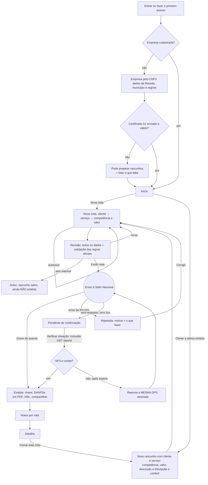

## 2.3 Telas

| # | Tela | Imagem |
|---|---|---|
| 1 | **Entrar**: usuário (CPF, CNPJ ou e-mail) e senha, como no Portal da NFS-e; explica que não usamos a senha gov.br | 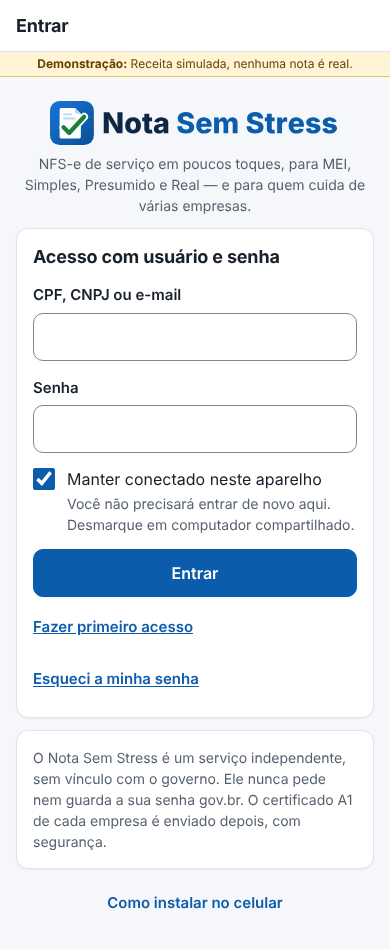 |
| 2 | Primeiro acesso | 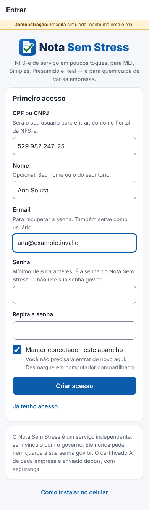 |
| 3 | **Empresa pelo CNPJ**: razão social, endereço e enquadramento vêm da base pública | 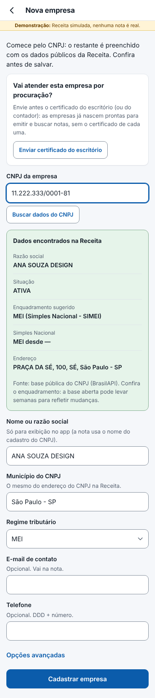 |
| 4 | Dados da empresa com a lista "O que falta para emitir" | 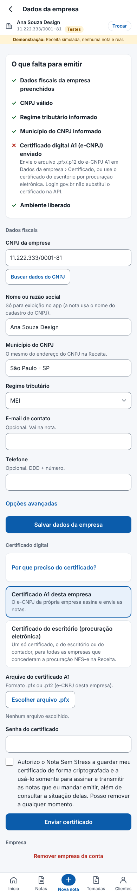 |
| 5 | Dados da empresa: tudo pronto, com o certificado verificado e guardado cifrado | 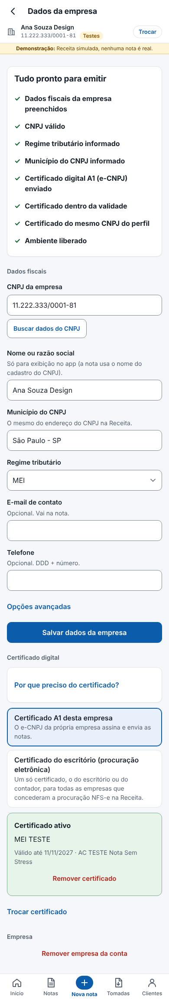 |
| 6 | **Início**: alerta mais urgente, Nova nota, Clonar a última emitida, resumo do mês e do ano, gráfico de 6 meses, limite anual do MEI, notas recentes e atalhos | 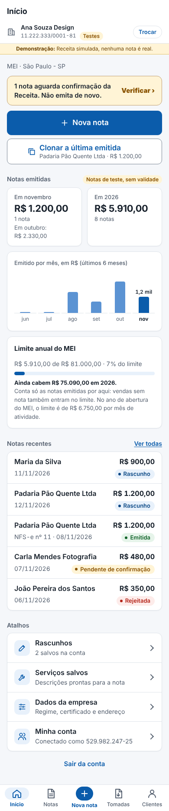 |
| 7 | **Cliente**: CPF/CNPJ, com endereço exigido só para CNPJ | 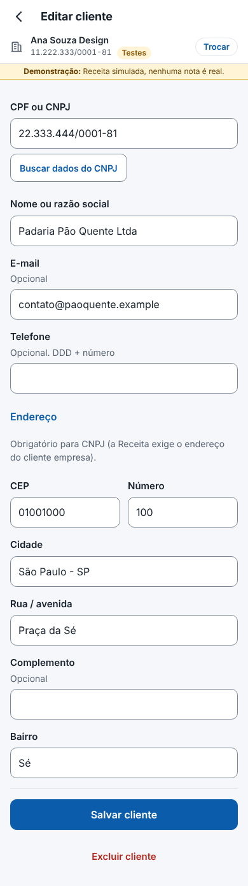 |
| 8 | Clientes: busca por nome, CPF ou CNPJ | 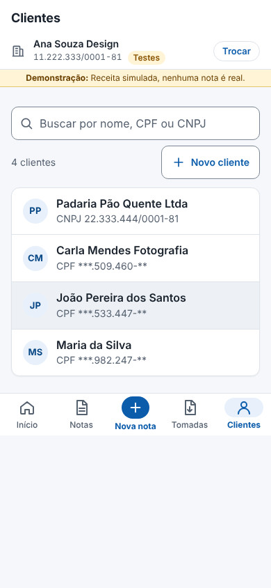 |
| 9 | **Serviço salvo**: código da lista nacional, descrição e valor de costume | 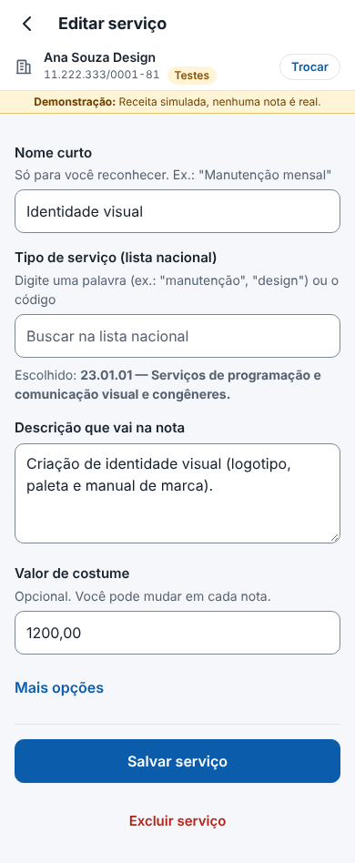 |
| 10 | **Nova nota**: cliente, serviço, competência e valor; tributação do MEI explicada | 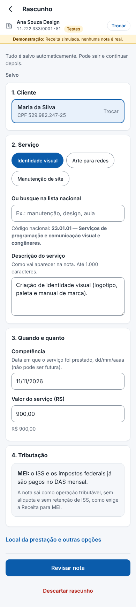 |
| 11 | **Revisão**: todos os dados antes de "Emitir nota" | 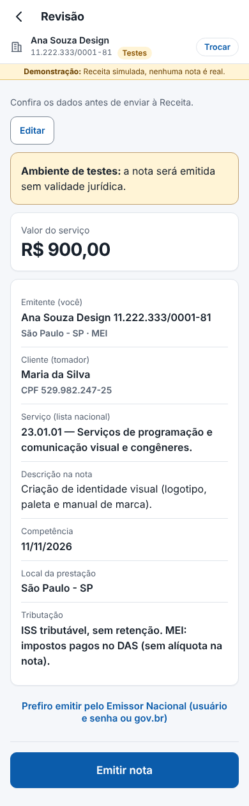 |
| 12 | **Resultado — Emitida**: "Enviar ao cliente" (DANFSe em PDF + XML), ver DANFSe, baixar XML e chave de acesso | 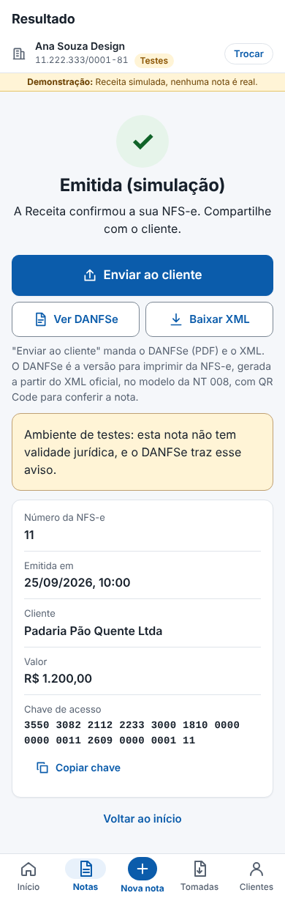 |
| 13 | **Nota clonada**: campos a conferir destacados | 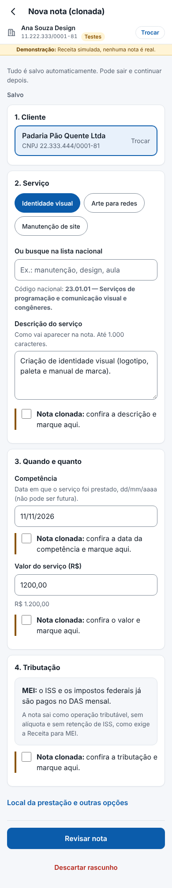 |
| 14 | **Resultado — Rejeitada**: motivo em linguagem comum + código oficial | 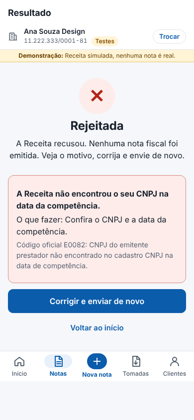 |
| 15 | **Resultado — Pendente de confirmação**: "não emita de novo" | 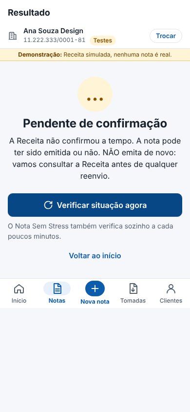 |
| 16 | **Notas**: filtro por situação, busca, competência, blocos por mês com o total emitido e "Exportar CSV" | 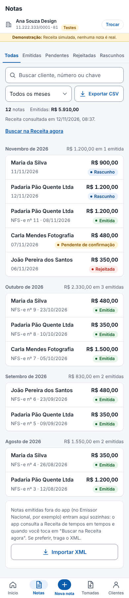 |
| 17 | Detalhe da nota, registro de comunicação e "Clonar esta nota" | 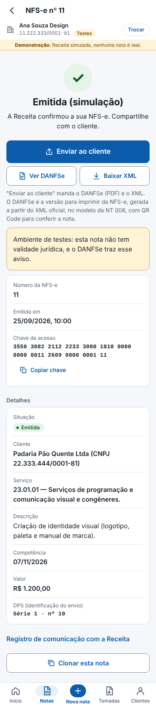 |
| 18 | **Notas tomadas**: NFS-e que fornecedores emitiram para a empresa, com totais | 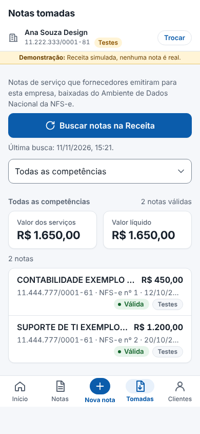 |
| 19 | Sem internet: prepara o rascunho, com aviso de que não foi emitida | 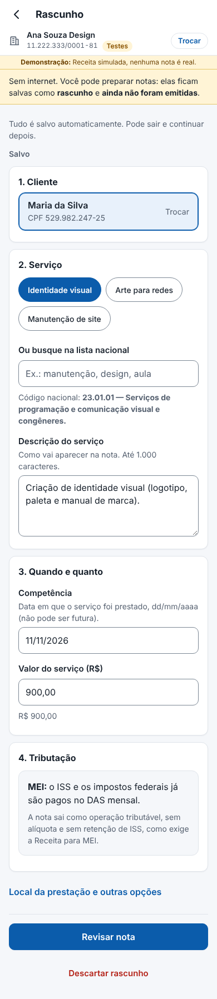 |
| 20 | **Instalar na tela inicial** (Android e iPhone) | 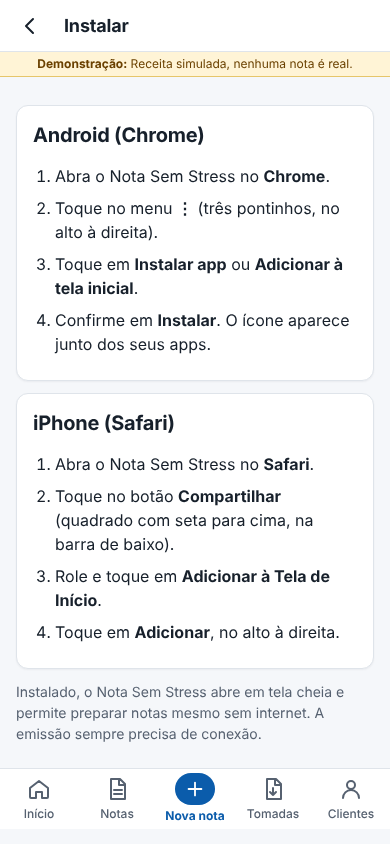 |

### ME/EPP do Simples Nacional

Os campos extras aparecem **só para ME/EPP**, e a alíquota do ISS aparece **só quando a regra oficial exige** (retenção pelo cliente, ou ISS fora do Simples em município não conveniado).

| # | Tela | Imagem |
|---|---|---|
| 21 | Dados da empresa: regime "ME/EPP — Simples Nacional", forma de apuração, % de tributos e alíquota do ISS para retenção | 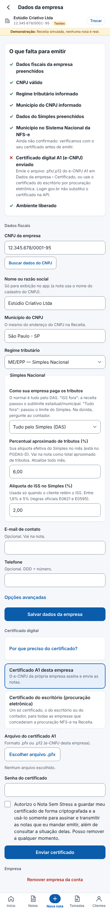 |
| 22 | Nova nota: "O cliente vai reter o ISS" e alíquota com o valor do perfil | 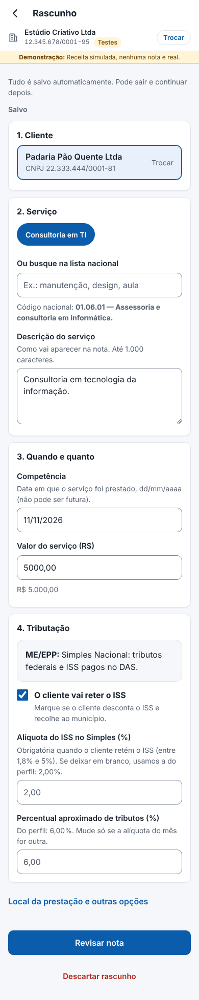 |

### Lucro Presumido / Lucro Real

A seção de tributação mostra ISS (retenção e alíquota só quando exigida), **retenções federais** no formato da NT 007 (PIS/COFINS/CSLL somados) e o **IBS/CBS** com as opções oficiais para o serviço (NBS, forma de prestação, classificação).

| # | Tela | Imagem |
|---|---|---|
| 23 | Dados da empresa: Lucro Presumido, PIS/COFINS (com alíquotas padrão a confirmar), tributos aproximados e alíquota do ISS | 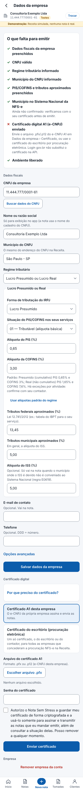 |
| 24 | Nova nota: ISS retido, retenções federais e IBS/CBS (NBS e uso pessoal) | 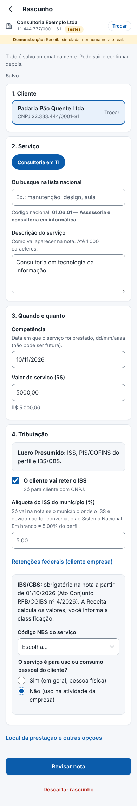 |

### Várias empresas, tema escuro e computador

| # | Tela | Imagem |
|---|---|---|
| 25 | **Empresas** da conta: busca, filtros e o que precisa de atenção em cada uma | 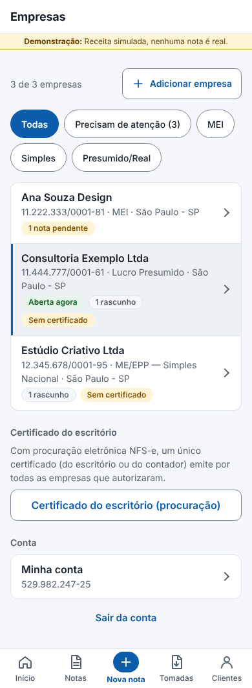 |
| 26 | Início no tema escuro (segue o aparelho) | 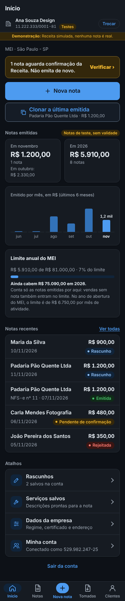 |
| 27 | Início no computador: barra lateral, empresa aberta no cabeçalho e resumo numa linha | 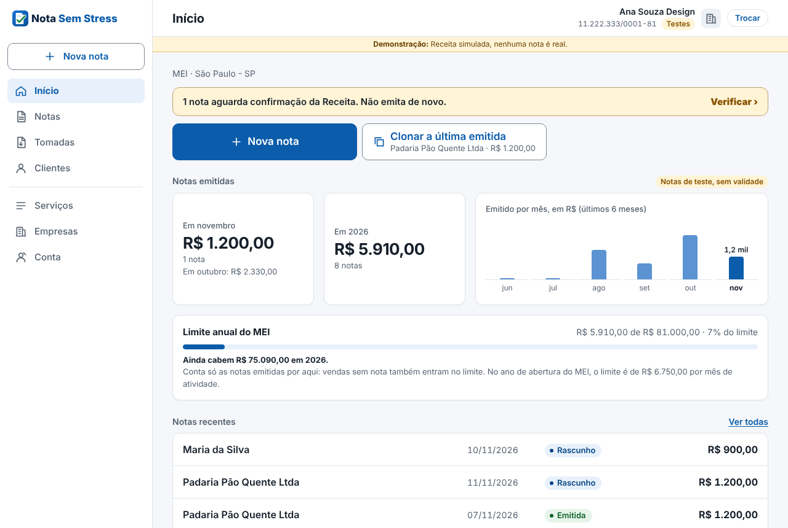 |
| 28 | Notas no computador: colunas alinhadas, como tabela | 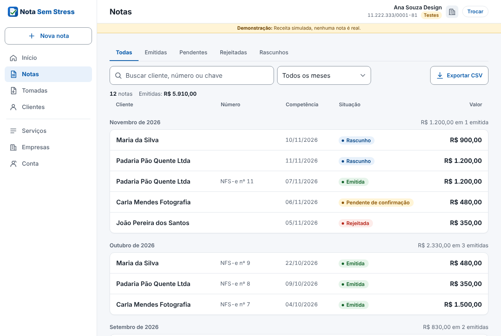 |

### DANFSe (NT 008)

O DANFSe é gerado pelo servidor a partir do XML oficial da NFS-e. Abaixo, o do modo demonstração: tem "NFS-e SEM VALIDADE JURÍDICA" (homologação) e a marca d'água "SIMULAÇÃO". [Exemplo em PDF](exemplos/danfse-demonstracao.pdf).

| # | Tela | Imagem |
|---|---|---|
| 29 | DANFSe em PDF, página única, com QR Code da Consulta Pública | 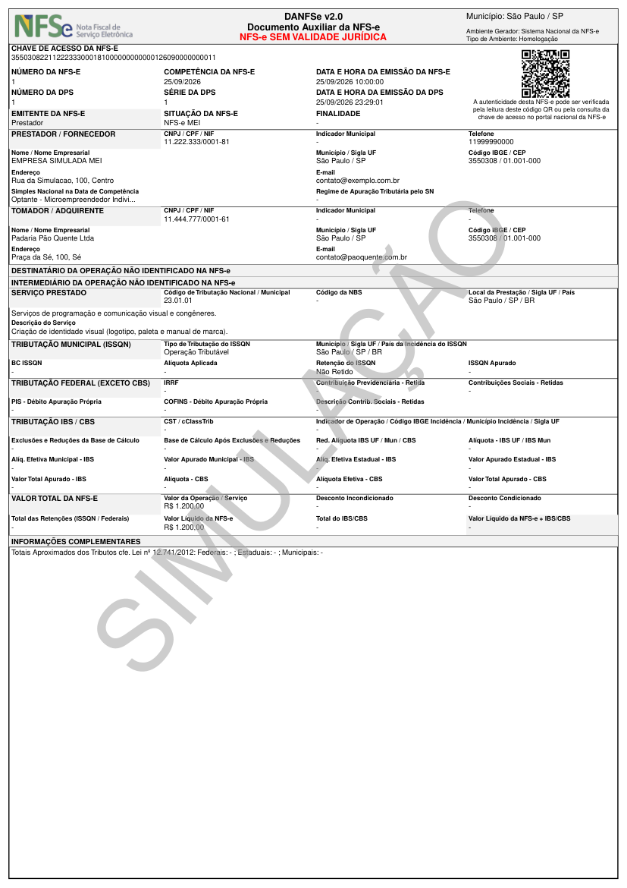 |

## 2.4 Navegação

- Celular: abas fixas **Início · Notas · Nova nota · Tomadas · Clientes**; telas de tarefa (nova nota, revisão) escondem as abas e deixam a ação principal fixa no rodapé. Serviços salvos, rascunhos, dados da empresa e conta ficam nos atalhos do Início.
- Computador (≥ 1024 px): barra lateral com as mesmas áreas mais Serviços, Empresas e Conta; a empresa aberta (nome, CNPJ e ambiente) fica no cabeçalho; listas viram tabelas e o número de colunas acompanha a largura.
- Filtros e competência ficam no endereço (`#/notas?situacao=emitida&mes=2026-10`); voltar de um detalhe devolve a lista na mesma posição.
- A escolha de cliente ou serviço a partir da nota abre a lista em "modo seleção" (`#/clientes?para=<nota>`) e volta para a nota com o item aplicado. Dá para cadastrar um novo cliente no meio do caminho sem perder a nota.
- Atalhos do ícone instalado (manifest): "Nova nota", "Clonar a última emitida", "Clientes".

## 2.5 Instruções de instalação (também dentro do app, em Conta › Instalar na tela inicial)

**Android (Chrome):** abrir o Nota Sem Stress no Chrome → menu **⋮** → **Instalar app** (ou **Adicionar à tela inicial**) → **Instalar**. Quando o navegador permite, o app mostra o botão **Instalar agora**.

**iPhone (Safari):** abrir o Nota Sem Stress no Safari → botão **Compartilhar** (quadrado com seta para cima) → **Adicionar à Tela de Início** → **Adicionar**.

## 2.6 Identidade visual

- **Persona:** dono de MEI ou de pequena empresa, no celular, sem formação fiscal. Quer emitir a nota do mês em menos de um minuto e ter certeza de que deu certo.
- **Personalidade:** confiável e acolhedora. Azul institucional para transmitir segurança, verde reservado à confirmação ("Emitida"), vermelho e âmbar só para erro e atenção.
- **Logo:** um documento com um "✓" verde que sai da folha: a nota pronta, sem stress. O check é o mesmo sinal de "Emitida" dentro do app. Funciona de 16 px (favicon) a 512 px e tem versão *maskable* para Android. Logotipo em Inter ExtraBold convertida em curvas: "Nota" em tinta escura e "Sem Stress" em azul, com versão para fundo escuro. No ícone instalado, o nome curto é "Sem Stress", porque "Nota Sem Stress" é cortado nas telas iniciais do Android e do iPhone.
- **Tokens:** azul `#0b5cab`, verde `#116329`, vermelho `#b42318`, âmbar `#8a5300`, tinta `#17202b` sobre fundo `#f5f7fa`; fonte do sistema; texto de 16 px; espaçamento em múltiplos de 4 px; raio de 12 px (10 px nos controles). Tudo fica em `web/css/app.css`, com as versões do tema escuro; nenhum componente usa cor literal, e os pares de cor passam no contraste AA nos dois temas. A página de apresentação (`docs/index.html`) usa a mesma paleta.
- **Padrões de tela:** listas em bloco com divisórias (tabela no computador), situação sempre com texto e cor, estado vazio com o próximo passo, erro com "Tentar de novo", esqueleto de carregamento só quando a tela demora.
- **Arquivos:** `web/icons/` (logo.svg, logo-escuro.svg, icone.svg, icone-maskable.svg, PNG 180/192/512, favicon de 32 px) e cópias em `docs/assets/`.
